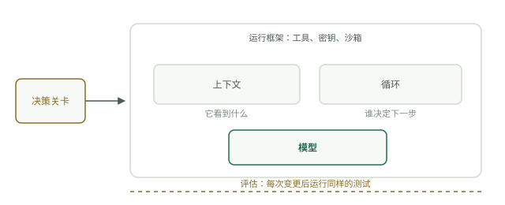

# 五个层次，一个系统

把智能体想成第一天上班的新员工。他聪明、动作快，却对你的公司一无所知。决定他能否成功的是你在他周围搭建的系统，而这个系统恰好有五个层次。

业内谈起这些层次，常常像在谈互相竞争的流派：上下文工程、循环工程、JEV 工程、运行框架工程、评估工程。五个流行词、五个会议分会场、五个人各自告诉你另外四个都是炒作。其实它们并非相互竞争的路线，而是同一系统的五个层次，分别回答一个问题：它看得到什么、谁决定下一步、谁负责分流、它能触及什么、你如何判断它是否有效。

## 上下文：它看得到什么

任务开始时，他桌上放着什么。任务说明、相关文件、真正重要的那一页历史，除此以外不放别的。模型只能对窗口内的内容进行推理，窗口外的一切对它而言都不存在。缺少这一层，智能体就会猜测，对从未见过的信息编造看似合理的答案，并反复索要已经给过的东西。糟糕的上下文经常被误诊为模型能力不足。

## 循环：谁决定下一步

他按清单工作，还是自己决定下一步？清单就是工作流：便宜、可预测，但遇到第一个意外就会失效。自主选择步骤就是智能体循环：灵活、昂贵，也可能漫无目的地徘徊。如果不认真设计循环，你就会得到这两种失败之一：一遇到意外就坏掉的脚本，或者围着同样三个文件打转、不断消耗 token 的游荡者。

## 决策关卡：谁负责分流

这相当于负责分拣邮件的前台。并非每个请求都值得交给昂贵的员工处理。一个小而快的决策机制，可以是分类器、便宜的模型或规则，负责把琐碎事项分出去，把真正的工作送进来。没有决策关卡，一切都会进入最昂贵的路径，包括垃圾内容、重复请求，以及根本不该接触持有权限的智能体的流量。

## 运行框架：它能触及什么

这就是他的办公室：桌上的工具、钥匙圈里的钥匙，以及成果对外发出之前负责检查的人。权限、沙箱、超时和审核都在这里。没有运行框架，智能体要么毫无用处，只能决策、不能行动；要么十分危险，能对一切采取行动，而且行动生效前没人检查。

## 评估：你如何判断

每个月做同一套测试。它不是演示，也不是改完提示词后凭感觉看看，而是一组答案已知的固定任务，在每个版本上运行。没有评估，你只能感觉某个改动是否有帮助，而回归问题最终会由用户发现。

## 全景图

某一层的故障往往伪装成另一层的问题：缺少上下文看起来像模型愚笨，缺少决策关卡看起来像成本失控，缺少评估则在上线之前看起来什么问题都没有。本课程每层对应一个模块，其中四层另有专题手册。这种划分是整个网站的约定：模块按顺序把概念讲一遍；手册收录完整的技术、工具和实践项目，供你在那一层遇到问题时查阅。

| 层次 | 问题 | 模块 | 手册 |
| --- | --- | --- | --- |
| 上下文 | 它看得到什么？ | [模块 1：模型如何读取上下文](../course-1-context/how-models-read.md) | 模块 1 本身就是深入讲解 |
| 循环 | 谁决定下一步？ | [模块 2：循环与工作流](../course-2-loop/loops-vs-workflows.md) | [什么是循环工程](../track-loop/what-loop-engineering-is.md) |
| 决策关卡 | 谁分流传入的工作？ | [模块 3：廉价决策](../course-3-gate/cheap-decisions.md) | [System One 模型](../track-jev/system-one-models.md) |
| 运行框架 | 它能触及什么？ | [模块 4：工作环境](../course-4-harness/the-office.md) | [什么是运行框架](../track-harness/what-a-harness-is.md) |
| 评估 | 你如何知道它有效？ | [模块 5：两类检查](../course-5-evals/two-kinds-of-checks.md) | [为什么需要评估](../track-evals/why-evals.md) |

## 自我检查

- 智能体不断索要一个两步之前还在上下文里的文件。是哪一层出了问题？为什么它看起来像模型的问题？
- 同事坚持认为评估工程已经取代了提示词工程。请用这五个问题解释，为什么这种说法混淆了不同类别。
