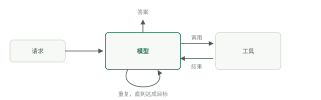

# 什么是智能体

Google 的[智能体入门](https://www.kaggle.com/whitepaper-introduction-to-agents)白皮书（Kaggle，2025 年 11 月）将智能体定义为会制定计划、采取行动以实现目标的应用，而不是回答问题的模型。这个定义听起来平淡，推论却并不平淡：模型只是四个组件之一，而且通常不是出故障的那个。

## 模型、工具与编排

白皮书列出了四个组件。模型是大脑：决定下一步做什么的推理引擎。工具是双手：API、代码执行、数据库查询，以及任何让推理能够接触真实世界的机制。编排层是神经系统：负责组装上下文、调用模型、执行模型要求的操作，并将结果反馈回去的循环。部署是身体：托管、日志、监控，以及其他不那么光鲜的部分。

循环是容易被低估的部分。白皮书描述了思考—行动—观察的周期：智能体接收任务，审视现有条件，规划一步，执行它，观察发生了什么，然后重复，直到目标实现。去掉各种品牌包装，智能体就是一个在步骤之间不断重建模型上下文的循环。

## 自主能力的五个等级

白皮书没有把系统简单分成两类，而是给出了等级：

- 0 级：裸模型，只根据训练数据推理。没有工具，也没有记忆。
- 1 级：联网的问题解决者，模型加工具，因此能获取自己不知道的信息。
- 2 级：具有策略的问题解决者，能够制定多步计划，并有意识地管理上下文。
- 3 级：协作式多智能体系统，专业智能体把彼此当作工具使用。
- 4 级：自我演进的系统，发现能力缺口时会构建新工具或新智能体。

目前真正部署到生产环境的大多数系统处于 1 级和 2 级。这不是批评，因为回报主要就在这里。

## 不是聊天机器人，也不是工作流

聊天机器人一次回答一条消息，每个后续步骤都由人来决定。按照 Anthropic 的定义，工作流是模型调用与工具沿着预先编写的代码路径运行的系统。智能体则由模型主导自身过程，根据刚刚观察到的情况决定下一步。分界问题始终只有一个：谁决定接下来发生什么，是人、你的代码，还是模型？

## 智能体在哪些场景有价值

白皮书自身给出的案例覆盖了不同规模。小到客服智能体，通过自行调用订单查询和物流跟踪 API 来回答“我的订单在哪里”，而不是遵循脚本化决策树。大到 Google 的 Co-Scientist，由监督者把任务交给负责生成、反思、排序、演进和元审查的专业智能体，在数小时或数天内完善科学假设；还有 AlphaEvolve，它提出并测试候选算法，已经在数据中心效率和矩阵乘法方面取得改进。

共同点是：步骤无法预先写定，但结果可以检查。凡是步骤可以写清楚的地方，就把它们写下来，这正是[智能体还是工作流](agents-or-workflows.md)讨论的论点。四个组件只描述了一名工作者的内部构造；它周围的系统则是[五个层次](five-layers.md)。

## 自我检查

- 说出白皮书给出的四个组件。其中哪个包含思考—行动—观察循环？
- 你的系统以固定顺序调用模型三次，没有分支。它属于哪一级？它算智能体吗？
