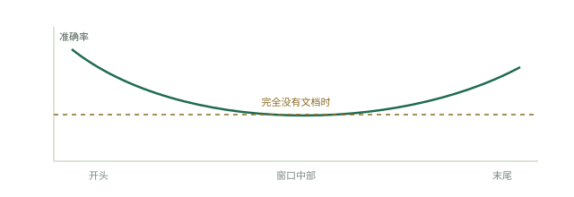

# 模型如何读取上下文

更大的上下文窗口看起来像免费的容量，但事实并非如此。模型会读取你发送的每个 token，却不会给予它们同等权重。超过某个点之后，每多一个 token，不仅会让答案更慢、更贵，还会降低质量。本页介绍底层机制；[四个位置](the-four-places.md)则介绍由这些机制推导出的实践原则。

## 注意力有自己的形状

在 [迷失在中间](https://arxiv.org/abs/2307.03172)（Liu 等，2023）中，研究者让模型根据一组检索文档回答问题，并改变唯一包含答案的文档在这组材料中的位置。在 20 份文档的设置下，答案位于第一份文档时，GPT-3.5-Turbo 得分为 75.8%；位于中间时为 53.8%；位于末尾时为 63.2%。闭卷基线，即同一个问题不附任何文档，得分是 56.1%。答案明明在窗口内，却埋在中间时，模型表现甚至不如什么材料都不给。

相同的 U 形曲线出现在 GPT-3.5-Turbo（4K 和 16K）、Claude 1.3（包括 100K 版本）、MPT-30B-Instruct、LongChat-13B，以及包含 10、20、30 份文档的材料组中。模型强烈关注窗口开头（首因效应）和末尾（近因效应），对中间内容的关注较弱。较新的模型让曲线更平，但尚无模型消除这一现象。Google 的白皮书[上下文工程：会话与记忆](https://www.kaggle.com/whitepaper-context-engineering-sessions-and-memory)（Milam 和 Gulli，2025 年 11 月）把更广泛的这类失败称为“上下文腐化”：上下文越长，模型关注关键信息的能力越弱。

## 每个 token 都有四种代价

同一份白皮书列出了长上下文的四项现实限制：窗口硬上限、API 成本、延迟和质量。窗口上限最让人担心，却往往最后才真正成为问题。成本、延迟和质量从第一个不必要的 token 开始，就会持续恶化。

成本会在智能体循环中累积。每一轮都会重发完整历史，因此一个有 N 轮的循环大约要为自己的上下文支付 N 次费用。一个跑了 30 轮、携带 20,000 token 无用内容的任务，浪费的不是 20,000 token，而是大约 600,000。延迟以同样方式增长；当你关心的信号逐渐移向窗口中注意力较弱的位置时，质量也会下降。

## 提示词缓存奖励稳定不变的前缀

服务商会以大幅折扣重新提供未变动前缀的计算结果。Anthropic 的[提示词缓存](https://platform.claude.com/docs/en/docs/build-with-claude/prompt-caching)对大多数模型的缓存读取收费为基础输入费率的 0.1 倍，也就是便宜十倍；默认有效期为 5 分钟的缓存写入收费为 1.25 倍，1 小时缓存则为 2 倍。

限制非常严格：要命中缓存，从开头到缓存断点的前缀必须逐字节 100% 相同。缓存有层次顺序：先是工具，然后是系统提示词，再是消息。因此修改一个工具定义会使它后面的所有内容失效，而系统提示词的任何变更都会使整个消息历史缓存失效。在系统提示词里放入时间戳，会保证每一次调用都不命中缓存，并悄悄让你支付完整的 10 倍费用。此外，模型还有可缓存的最短长度要求，依模型不同介于 512 到 4,096 token；低于该长度会直接跳过缓存，而且不会报错。

## 解决方案的轮廓

这些机制指向同一个方向。永远不变的内容应放在最前面，那里既便宜（有缓存），又能获得充分注意（首因效应）。当下最重要的内容应放在最后面，利用近因效应。体量大或临时性的内容则应彻底移出窗口，保存在磁盘上，需要时再读取。下一页介绍这种摆放原则；运行框架手册还[更深入地讨论](../track-harness/context-engineering.md)了如何将它接入真实智能体。
