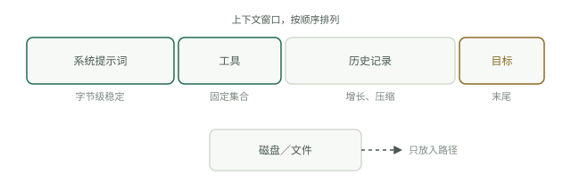

# 四个位置

[模型如何读取上下文](how-models-read.md)解释了基本机制：注意力偏向窗口的开头和末尾，每个 token 都有成本，只有前缀始终不变，缓存才有价值。由此推导出的原则很容易说明：每一块上下文都应该放在四个位置中的一个，而大多数智能体问题，都能追溯到内容放错了位置。




<a id="one-the-system-prompt"></a>

## 第一处：系统提示词

只放每次调用都成立的内容：角色设定、硬性规则、输出格式，除此之外不放别的。它必须逐字节稳定：没有时间戳、用户名、检索到的记忆，也没有“当前任务”。系统提示词中的任何动态内容都会让每个请求的缓存失效，因为系统提示词位于消息之上的缓存层级；它也会把宝贵的首因位置浪费在不需要放在那里的内容上。修改它应被视为一次发布，而不是随手微调。

<a id="two-the-tools"></a>

## 第二处：工具

工具集在整个对话期间保持固定。绝不要在运行中增删定义：工具处于缓存层级的最前面，改动一个定义就会让整个缓存前缀失效，也会让模型行为随之变化。工具必须停用时，改为拦截调用，返回“此工具在当前任务中已停用”，而工具定义保持不变。

定义的开销很大。Anthropic 的[高级工具使用](https://www.anthropic.com/engineering/advanced-tool-use)文章（2025 年 11 月）测得，一个常见的五服务器 MCP 配置有 58 个工具，在对话开始前就消耗约 55K token；他们内部还曾在优化前遇到 134K token 的工具定义。工具少于大约二十个时，可以全部加载；超过后应改用工具搜索，具体见[上下文实践](context-practice.md)。

<a id="three-the-disk"></a>

## 第三处：磁盘

凡是体积大或需要长期保留的内容，都放进文件；窗口中只留下路径。保留索引键，不保留全部内容。一个抓取了 40,000 token 网页的工具，不应直接返回整个页面：

```python
import hashlib, pathlib, urllib.request

def fetch_to_disk(url: str) -> str:
    text = urllib.request.urlopen(url).read().decode("utf-8", "replace")
    path = pathlib.Path("cache") / (hashlib.sha1(url.encode()).hexdigest() + ".txt")
    path.parent.mkdir(exist_ok=True)
    path.write_text(text, encoding="utf-8")
    return f"saved {len(text)} chars to {path}"
```

智能体在需要时读取文件片段。窗口里只留一份约 15 token 的回执，而不是整篇文档。

<a id="four-the-tail"></a>

## 第四处：尾部

窗口末尾是你拥有的注意力最充足的位置。每隔几步，就在最新工具结果之后用一两行重申当前目标。在长循环里，最初的指令已逐渐落入注意力较弱的中间区域；每轮花大约三十个 token 在尾部重述目标，能让模型持续围绕任务工作。

<a id="what-survives-the-session"></a>

## 会话结束后保留什么

Google 的[会话与记忆白皮书](https://www.kaggle.com/whitepaper-context-engineering-sessions-and-memory)清晰地区分了两者：会话是一次对话的工作台，记忆则是跨对话保留的档案柜。这里的定义很重要：记忆是提取后的信息，而不是原始对话。你不应该只归档记录，而应该先运行提取，让 LLM 仅抽出符合指定主题的事实，例如偏好、决策和目标；再进行整合，将新事实与已有事实比较，合并、更新，或在发生矛盾时删除。两项工作都在回复发送之后于后台执行，绝不进入关键响应路径。跨会话保存的是提炼后的记录：稳定偏好、长期决策、来之不易的事实。原始对话则留在磁盘上，作为来源依据。

<a id="compacting-the-window"></a>

## 压缩窗口

针对进行中的会话，白皮书给出了复杂度逐步提升的三种策略：只保留最近 N 轮的滑动窗口；基于 token 的截断，即从最新内容开始填满预算；递归摘要，即用滚动摘要替换较早的轮次，并放在保留原文的近期轮次之前。可以按数量阈值、闲置时间或任务完成情况触发压缩。循环手册的[上下文维护](../track-loop/context-hygiene.md)一章更深入地讨论了长循环内的压缩。
