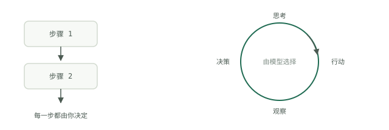

# 循环与工作流

工作流是你提前写好的序列：第一步、第二步、第三步，结束。循环只有一点不同：下一步由模型在运行时，根据刚刚发生的情况选择。周期是思考、行动、观察、决策，然后重复：模型提出行动，行动被执行，结果进入历史，某个机制再决定是否继续。Google 的《智能体入门》白皮书（Kaggle，2025）将同一周期表述为接收任务、观察场景、思考、采取行动，再观察并迭代，由模型、工具和编排三者支撑。用词可能不同，形态并没有变。

## 谁选择下一步

这就是全部区别。在工作流里，你在设计时选择了每一步；代码只是重放这些决策，相同输入每次都走相同路径。在循环里，模型在运行时选择，因此相同输入的两次运行可能走不同路径。这正是它的价值所在，也是问题所在。Google 白皮书将这种变化描述为开发者从砌砖工变成导演：不再铺设每一步，而是设定目标、挑选工具，让系统自行选择路径。导演式管理比砌砖更昂贵，也更难审计。

## 两者分别何时胜出

只要你能列举步骤，工作流就会胜出。输入形状已知、故障模式已知、路径能画在白板上，就把它写成普通代码。它能在毫秒内运行，每条分支没有额外成本，不会凭空编造步骤，出了问题也能在调试器里明确呈现。今天许多被构建成“智能体”的系统，实际上应该是内部包含一两次模型调用的工作流。

只有当路径确实无法预先写定时，循环才会胜出：调试陌生故障、调查原因可能有上百种的告警、持续修改代码直到外部测试通过。未知的是分支，不是工作本身。如果你发现自己正在写“智能体会先检查 X，再检查 Y，然后检查 Z”，你其实已经写出了工作流，直接交付它就好。

## 成本计算

自主性以 token 计价。Anthropic 关于其多智能体研究系统的工程文章（2025 年 6 月）直接测量了这些比例：智能体循环消耗的 token 约为单次聊天交互的四倍，多智能体系统约为十五倍。因此，循环提供的价值要达到普通调用约 4 倍，一组智能体则约为 15 倍，才值得投入。不可预测性还会进一步放大账单。Google 的《从原型到生产》白皮书指出，智能体执行轨迹是动态组装的，因此每次运行的成本和延迟不可预测；生产化工作中大约 80% 用于基础设施、安全与验证，而不是智能体的智能本身。你支付的不仅是每次运行更高的费用，还包括将运行限制在边界内所需的整套机制。

## 一条决策规则

只问一个问题：我能提前写出步骤吗？

- 完全能：使用工作流，控制流程不需要模型参与。
- 能，只有一个判断例外：使用工作流，在那个位置加入一次模型调用。
- 不能，路径取决于每一步揭示的信息：使用循环，并用[循环的四个部分](the-four-parts.md)约束它，即可测试的目标、外部检查器、停止规则和预算。

默认采用能完成实际任务的最便宜结构，只有证据充分时才升级。有意识地设计这种有边界的周期，而不是手工反复提示，就是[循环工程](../track-loop/what-loop-engineering-is.md)。把两种结构连接起来的生产模式，即先过滤、短暂循环、最后回退，将在[循环实践](loop-practice.md)中完整实现。
