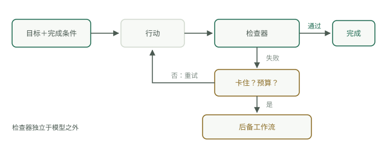

# 循环的四个部分

每一个能在生产环境中可靠运行的循环，都有同样的四个部分：带有可测试完成定义的目标、位于模型外部的检查器、停止规则，以及同时用轮次和金额计量的预算。拿掉其中任何一个，都不是简化循环，而是拆掉它的刹车。本页逐一深入说明这四个部分，然后注释一个标准骨架。




<a id="a-goal-with-a-testable-done"></a>

## 带有可测试完成条件的目标

“改善错误处理”无法让循环终止，因为没有什么机制能宣布它已经完成。“`tests/` 下的全部测试通过，且代码检查器没有报告任何问题”则可以。目标必须表述成程序能够返回真或假的条件，而不是依赖人或模型判断。如果你无法把完成定义写成检查条件，就还没有一个适合循环执行的任务，而只是一次交互会话。把完成定义写成四十行脚本本身就是一项技能，[目标测试实践](../track-loop/build-goal-test.md)将具体实现它。

<a id="a-checker-outside-the-model"></a>

## 位于模型外部的检查器

检查器可以是测试套件、编译器、代码检查器或模式验证器，总之是无需询问模型意见、就能机械判断结果的机制。自我审查不是检查器。这里有直接证据：Huang 等人的《大语言模型尚不能自行纠正推理》（ICLR 2024）发现，缺少外部反馈时，模型很难修正自己的推理，有时自我修正后表现反而更差。模型给自己的工作打分，相当于同一套权重把同一个错误犯两遍，而且第二遍更自信。因此，外部检查器不可缺少：让循环收敛的反馈，必须来自产生错误的系统之外。这也是编程任务最适合循环的原因，编译器和测试运行器天然就是免费、快速、外部的检查器。

<a id="a-stop-rule"></a>

## 停止规则

有三个出口，任意一个满足就结束运行：检查器通过，即成功；达到轮次上限，即尝试次数用尽；或者连续两次尝试完全相同，即循环正在原地打转，继续只会花钱。最后一条很重要，因为空转往往很安静：同一个失败测试、同一份空差异，一次又一次。包括单向推进机制和指纹检测在内的完整停止方案，见[停止条件](../track-loop/stop-conditions.md)。

<a id="a-budget-in-turns-and-dollars"></a>

## 同时限制轮次和金额

轮次和金额会以不同方式失控，因此两者都要设上限。轮次上限约束尝试次数；金额上限限制单轮突然膨胀时造成的损失。一次返回巨大载荷的工具调用，可能比十个正常轮次还贵。只有轮次上限、没有支出上限的循环，仍是一张金额上限未知的账单。

<a id="the-skeleton-annotated"></a>

## 带注释的骨架

```python
for turn in range(MAX_TURNS):                      # budget, part one: turns
    action = model.next_step(goal, history)        # the model chooses the step
    result = run(action)                           # the world responds
    history.append(result)                         # the observation survives
    if checker(result):                            # external judge, never the model
        break                                      # stop rule 1: done
    if repeated(history, 2):                       # stop rule 2: spinning
        break
    if spent() > BUDGET:                           # budget, part two: dollars
        break
else:
    fallback_workflow(goal)                        # turns exhausted: fixed path
```

仔细看这些退出路径。Python 中的 `else` 子句附属于 `for` 循环，只有循环没有通过 `break` 退出时才执行，因此上述写法只覆盖一种失败模式：轮次耗尽。`repeated` 和预算检查触发的中断会直接退出，却不返回结果。所以在生产环境中，所有并非检查通过的退出都应进入同一个地方：回退工作流。这是一条无需模型、也能给出有依据答案的确定性路径。[循环实践](loop-practice.md)会完整实现这个版本。

还要注意骨架中省略了什么：没有“询问模型是否满意”。模型负责选择下一步，但无权投票决定工作是否完成。
