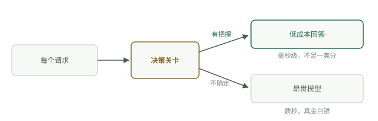

# 廉价决策

智能体做两类工作。一类是写作——摘要、计划、回复、代码；另一类是决策——这是否紧急、应该归入哪个文件夹、是否需要人来处理。写作是开放式的，确实需要大模型。决策则有明确边界：答案来自你已知的选项集合。大多数处理流水线把这两类工作都交给同一个前沿模型，相当于花钱请律师来分拣信封。

本模块介绍决策关卡：设置在昂贵模型前的一层廉价决策机制，负责分流输入，让前沿模型只接触真正需要判断的条目。

关于命名，补充说明一下：本模块按这个模式命名为“决策关卡”。它的深入讲解手册叫作 [Jev 工程](../track-jev/system-one-models.md)，取名自最常用于决策关卡的 System One 模型类别——一个介绍模式，另一个介绍实现该模式的一种有力方案。

## 两类工作

观察智能体处理收件箱，数一数它要做多少次决策。这是不是垃圾邮件？是不是新闻简报？涉及哪个项目？是否需要回复？完成这些决策后，才可能开始写作——而对于大多数条目，写作从不会发生；它们会被归档、存档或丢弃。前沿模型回答“这是不是新闻简报”，要消耗数秒时间和实实在在的费用，得到的却只有一比特信息。这个决策只值不到一美分。而少数确实需要写作的条目，才值得支付全价。

## 什么是决策关卡

决策关卡对每个条目只问一个范围明确的问题，再根据答案分流。结构始终一致：所有条目先进入关卡；每个条目都接受一个有明确边界的问题——在这些标签中选一个、回答是或否，或者给出一个分数；关卡有把握回答、属于常规情况的条目，交由廉价的确定性代码处理；关卡拿不准的条目则交给主模型。不确定就升级处理。决策关卡永远只是快捷路径，不会是唯一的路径。

## 决策关卡的分类

以下四类工具，成本和出错可能性依次上升：

- **规则。** 正则表达式、发件人允许名单、“是否包含退订链接”。免费、即时，但对预料之外的情况一无所知。始终应放在第一层，不能作为最后一层。
- **传统分类器。** 基于 TF-IDF 特征的逻辑回归或类似方法，用几百个你自己标注的样本训练。在自己的机器上以微秒级速度运行，每次调用没有成本，而且可以检查它的错误。
- **小型 LLM。** 提示 Haiku 级别的模型只回答一个词。不需要训练数据，也能应对新情况，但在这些廉价选项中，它最慢、最贵，而且必须解析文本才能拿到答案。
- **System One 模型。** TypeSafe AI 于 2026 年 9 月发布的 Jev 是首个此类模型：输出具有明确类型的决策——是/否、最多 255 个选项中的一个，或者有序量表上的一个标量——每个决策都附带置信分数，完全不生成文本。背景知识见 [System One 模型](../track-jev/system-one-models.md)。

## 决策关卡应该放在哪里

所有输入流汇聚的位置都适合。在资料导入时、任何内容到达主智能体之前：垃圾信息、重复内容以及纯参考资料，都不该消耗前沿模型的 token。在昂贵的工具调用之前：“这个查询是否需要上网”，就是一个决策关卡。在执行操作时，也可以用它作为防护措施：以是/否回答“这是否具有破坏性”，超过阈值就阻止操作。将它们分层安排——先用规则，再用分类器，只有通过前两层仍未解决的内容才交给模型。

设置决策关卡是架构选择，不是供应商选择。无论由哪种工具来承担，这套架构——问题范围窄、答案成本低、有疑问就升级处理——始终不变。到底该选择哪种工具，需要用自己的标注数据做实证判断，这也是下一篇的主题：[决策关卡的实际运用](gates-in-practice.md)。
