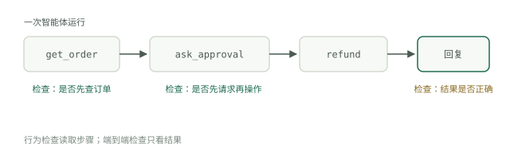

# 两类检查

前面的模块构建了一个能够制定计划、调用工具并编辑知识库的智能体。本模块讨论如何在用户告诉你之前，就知道它是否正常工作。智能体评估的一切，都建立在一个区别之上：检查结果，与检查行为。两者你都需要，而它们回答的是不同问题。

## 端到端检查

端到端检查只问一个问题：最终答案是否正确？运行输入，取最后一条消息或最终状态，然后评分——可以用精确匹配、评分标准或评判器。这正是用户会设计的检查，因为它衡量的就是用户实际体验到的结果。

它的优势也是局限。当修改提示词后，通过率从 84% 降到 71% 时，端到端测试套件只会告诉你分数变了，不会告诉你原因。你仍要逐份阅读失败的会话记录，因为失败可能来自检索、工具参数、遗漏的验证步骤，或最后的措辞。Google 的[智能体质量白皮书](https://www.kaggle.com/whitepaper-agent-quality)将这视为黑盒评估——“智能体是否实现了用户的目标？”——并配上观察执行过程的玻璃盒视角，其原则概括为“执行轨迹才是真相”。

## 行为检查

行为检查关注的是，在得到答案的过程中，某一件具体的事情有没有发生。智能体是否先调用搜索，再回答问题？请求含糊时，是否提出了澄清问题？声称任务完成之前，是否确认文件确实存在？每项检查都很窄、只有通过或失败两种结果，而且成本低——它是断言，不是主观判断。

收益在于诊断。两个智能体即使生成了同样的退款邮件，只要一个先查过订单，另一个只是猜测，它们就不能视为相同。端到端检查会给它们相同的分数；行为检查则能在今天就把它们区分出来，无需等到猜测的那个碰上猜错的订单。

## 执行轨迹是基础

行为检查基于执行轨迹运行：模型轮次、工具调用及其参数、工具结果、重试的完整记录。没有轨迹，就没有行为检查——因此白皮书主张，从第一行代码开始，就应为智能体加入评估所需的观测能力，以日志、轨迹和指标作为可观测性的三大支柱。如果你的智能体是 Claude Code 配置，会话记录本身就是轨迹；把它保存下来。该对轨迹做哪些断言——工具选择、参数提取、顺序约束、错误处理——在[智能体评估](../track-evals/agent-evals.md)中有深入讨论。

## 速度预算

将测试套件分成两层。快速层只包含确定性的行为断言：不调用模型、不访问网络，只用代码读取轨迹。要让它快到没人需要考虑是否运行——几秒钟，比如五秒，就是可行的预算。超过这个时间，它就会从“每次编辑后运行”变成“合并前运行”，反馈循环也随之消失。慢速层——带评判器的端到端运行——安排在每晚和发布前执行。[构建测试套件](../track-evals/build-suite.md)中的单文件结构，很自然就能扩展为这种划分。

## 两类检查各自的价值

端到端检查在决策节点发挥作用：发布版本、更换模型、比较两个提示词。行为检查则在开发过程中发挥作用：你修改了一处，希望几秒内就知道它影响了什么。

有一个陷阱从第一天就要避免：关注单项检查，不要只看总体通过率。总分可能上升，同时某种行为悄悄失效——五个不稳定案例开始通过，而智能体却不再在退款前请求批准。总分说这是进步，单项检查的历史却告诉你这是事故。慢速层如何评分，本身也是一个问题，这正是[评判器与黄金集](judges-and-golden-sets.md)要讨论的。
