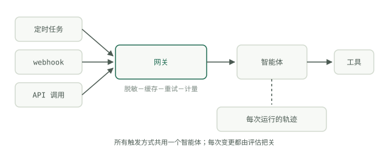

# 从原型走向生产

到目前为止，每个模块最后都会得到一个能在你自己机器上运行的东西。本模块讨论的是，当其他人——或者凌晨三点的调度器——开始依赖它时，会发生什么。Google 的《从原型到生产》白皮书（Kaggle，2025 年 11 月）开篇就坦言：“构建智能体很容易。信任它很难。”白皮书估计，交付智能体所需的工作中，约 80% 投入在基础设施、安全和验证上，而不是让智能体变得更聪明。

## 演示遇到真实流量，哪些地方会出问题

演示运行时，你在旁边看着，输入是你挑选的，用的也是自己的凭据。生产环境会一下子拿走这三种便利。失败清单并不难预测：

- **可靠性。** 供应商会超时、限流，偶尔还会返回无效内容。如果没有带退避的重试和幂等工具，一次不稳定的调用就会毁掉整个运行——而重试一个非幂等工具，会把同一封邮件发送两次。
- **成本。** 一个在你盯着时只花 40 美分的循环，没人看管时想花多少就花多少。对于无边界的运行，首先要设置[轮次和金额上限](../course-2-loop/loops-vs-workflows.md)。
- **输入。** 真实流量包含格式损坏的文件、恶意文本，以及你那三个测试提示词从未覆盖的边界情况。
- **变更。** 演示中的提示词，就放在你上一次粘贴它的地方。生产环境中，一次未纳入版本跟踪的提示词编辑，就是一次无法审查的部署。

白皮书将这种转变定义为 AgentOps 这一套方法：人工抽查变成自动化关卡，临时调整变成有版本管理的提示词和工具，“看起来没问题”变成日志、轨迹和指标。

## 三种部署形式，同一个智能体

生产环境中的智能体有三种调用方式：按**计划**运行（每晚的摘要）、由**事件**触发（文件到达、webhook 触发），或通过 **API** 提供服务（某个人或另一个系统立刻提出请求）。Palantir 的 AIP 架构描述的正是这三种方式——按计划自动化、近实时的事件驱动自动化、API 驱动的操作——它们都基于同一套底层数据和操作层运行。

这对设计的要求是：将智能体逻辑与触发方式分离。一份智能体定义，三个轻量适配器。如果定时运行版本和 API 版本分别维护两个代码库，那么每个修复都得做两次，其中一个迟早会偏离。

## 在每次模型调用前设置统一网关

最值得投入的单项基础设施就是网关——所有模型调用都必须经过的统一控制点，没有例外。它负责四件事：

- **脱敏。** 在敏感字段离开你的边界前，将其移除或进行假名化处理。
- **缓存。** 对重复的前缀和相同调用，返回缓存的生成结果。
- **重试与故障转移。** 将退避、备用供应商和紧急停用开关集中在一个地方。
- **Token 计量。** 为每次调用记录是谁触发的，以及花了多少钱。

成熟技术栈最终都会趋向这一模式：Palantir 将所有 LLM 访问都经由一个安全集成层，统一追踪 token 消耗并记录审计日志，而不是让每个应用直接调用供应商。你无需使用 Palantir，也能借鉴这个结构——一个 200 行的代理就能实现大部分功能。

## 白皮书描绘的路径

白皮书提出的生产化路径是一套生命周期，而非一次上线：开发阶段快速试验，预发布阶段进行自动化测试和模拟负载，生产阶段在监控下逐步放量。发布采用金丝雀或蓝绿部署，并能立即回滚，绝不一次性切换 100% 流量。评估套件在 CI 中运行，分数下降就阻止部署——模块 5 中的[两类检查](../course-5-evals/two-kinds-of-checks.md)成为关卡，而不仅仅是一张仪表盘。循环由此闭合：生产轨迹进入评估集，强化下一次发布。

这些都不新奇。它们只是把常规软件工程纪律应用到一个恰好具有概率性的组件上。下一篇讨论运维这一面：[系统运行后，如何观测、控制开销并保障安全](operating-agents.md)。
